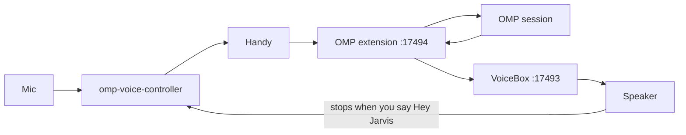

# voice-agent

Hands-free voice for a local [OMP](https://github.com/can1357/omp) session on a Mac.

You say **Hey Jarvis**, dictate, and say **send prompt**. The words land in the OMP draft and are submitted from there. OMP’s reply is spoken back on this Mac. Saying **Hey Jarvis** again stops playback so you can talk over it.

This is a listener and an OMP extension. It does not ship its own speech engine. Three apps you install yourself do the work:

| App | What it does here |
|---|---|
| [OMP](https://github.com/can1357/omp) (oh-my-pi) | The terminal session you are talking to. The extension in this repo types into its draft, submits, and speaks the reply. |
| [Handy](https://github.com/cjpais/Handy) | Speech to text. The listener starts and stops recording. You do not have to keep Handy’s window open. |
| [VoiceBox](https://github.com/jamiepine/voicebox) | Text to speech. One voice profile on this Mac speaks the reply. The profile name is local; this repo does not store it. |



## What you need

- macOS on Apple Silicon or Intel
- Homebrew
- A microphone, and permission for Handy and the terminal to use it
- The three apps above

Python packages for the wake word and silence detection are installed into `~/.local/share/omp-voice/venv` by the install script. You do not need a separate Python project.

## Set up

### 1. OMP

```sh
brew tap can1357/tap
brew install omp
```

Open the OMP session you want to talk to. The voice extension listens on `127.0.0.1:17494` when that session starts. If more than one session is open, the newest one takes the port.

### 2. Handy

Install [Handy](https://github.com/cjpais/Handy) so `Handy.app` is in `/Applications`. On first launch, allow the microphone and download an English model. Leave the app installed. In Handy’s settings, turn off “mute while recording” if that option is on.

### 3. VoiceBox

Install [VoiceBox](https://github.com/jamiepine/voicebox) and leave it running at `http://127.0.0.1:17493`. Create one voice profile in the app and remember its **name**.

Download a Qwen text-to-speech model in VoiceBox (0.6B or 1.7B). The listener uses **1.7B** by default. If a local model state file at `~/.local/state/strata/omp-autostart.json` says `"engine": "flash"`, it switches Handy and VoiceBox to the **0.6B** models so they can sit beside a large local model, and switches both back to 1.7B when that file no longer says `flash`. Without that file, both stay on 1.7B. Download both sizes only if you use that switch.

### 4. This repository

```sh
git clone https://github.com/ASabale/voice-agent.git
cd voice-agent
./bin/install "Your VoiceBox Profile Name"
```

`./bin/install` writes that name to `~/.local/state/omp-voice/profile`, creates the Python environment, and symlinks this checkout into the paths OMP and the listener actually run:

- `bin/omp-voice-controller` → `~/.local/bin/omp-voice-controller`
- `bin/omp-handy-hook` → `~/.local/bin/omp-handy-hook`
- `extension/voicebox-speech.ts` → `~/.omp/agent/extensions/voicebox-speech.ts`
- `grammar.json` → `~/.local/share/omp-voice/grammar.json`
- `skills/conversational-collaboration` → `~/.omp/agent/managed-skills/conversational-collaboration`

`OMP_VOICEBOX_PROFILE` overrides the profile file when it is set. Edit this checkout. Do not keep a second copy under `~/.local` or `~/.omp`.

Reload the OMP session so it picks up the extension (`/reload-runtime` inside OMP). Then:

```sh
omp-voice-controller start
```

Say **Hey Jarvis**, speak, pause, and say **send prompt**.

## Talking to it

| You say | What happens |
|---|---|
| Hey Jarvis | Playback stops, if any, and dictation starts |
| a pause of about 5 seconds | The chunk is transcribed into the OMP draft and dictation continues |
| send prompt | The draft is submitted |
| stop / pause listening / go to sleep | Dictation stops and the draft is kept |
| scratch that | The last chunk is removed |
| clear draft | The draft is emptied |

Command phrases are matched from `grammar.json`: one word from each slot, in order. Closing Handy’s window returns the listener to idle and does not open it again.

```sh
omp-voice-controller status
omp-voice-controller stop
```

Logs and status stay on the machine, under `~/.local/state/omp-voice/`. Handy’s transcription history and VoiceBox audio are also local. None of that is in this repository.

## What is in the repo

| Path | Role |
|---|---|
| `bin/omp-voice-controller` | Wake word, silence chunking, Handy, model tier, microphone |
| `bin/omp-handy-hook` | Forwards one Handy transcript into the controller |
| `extension/voicebox-speech.ts` | OMP extension: draft, submit, barge-in, speech |
| `grammar.json` | Ordered command slots |
| `skills/conversational-collaboration/` | How a spoken reply should behave while someone is talking |
| `docs/setup.md` | The same first-time steps, in longer form |

## What is not built

1. A phone bridge
2. Memory that survives across OMP sessions
3. A directory sandbox for remote use
4. A second model that holds a full-duplex conversation

## License

MIT. See [LICENSE](LICENSE).
