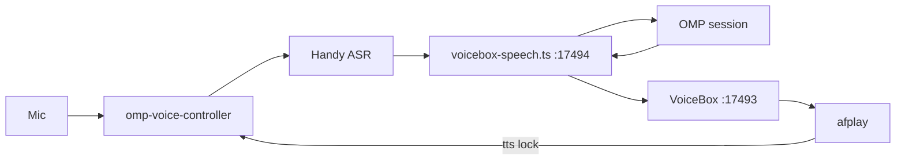

# voice-agent

Stage 1 hands-free loop for a focused [OMP](https://github.com/can1357/omp) terminal session on macOS.

Say **Hey Jarvis**, dictate in chunks, and say **send prompt** to submit. Replies are spoken by a local [VoiceBox](https://github.com/jamiepine/voicebox) profile. There is no separate broker model in this stage.

| Path | Role |
|---|---|
| `bin/omp-voice-controller` | Wake word, silence chunking, Handy, mic rebind |
| `bin/omp-handy-hook` | Forwards a Handy transcript into the controller |
| `extension/voicebox-speech.ts` | OMP extension: draft, submit, barge-in, TTS |
| `docs/` | Design notes for this stage and later ones |

## Layout on a machine

The clone is the only copy. [`./bin/install`](bin/install) symlinks it into place. First-time OMP, Handy, and VoiceBox steps are in [docs/setup.md](docs/setup.md).

- `extension/voicebox-speech.ts` → `~/.omp/agent/extensions/voicebox-speech.ts`
- `bin/omp-voice-controller` → `~/.local/bin/omp-voice-controller`
- Python deps in `requirements.txt` → `~/.local/share/omp-voice/venv`

The VoiceBox profile **name** goes in `~/.local/state/omp-voice/profile`, or in `OMP_VOICEBOX_PROFILE`. The profile id stays on the machine. This repo does not store it.

Local-only state (`~/.local/state/omp-voice/`, Handy `history.db`, VoiceBox audio) is not part of this repository.

## What is not built

1. Phone bridge over Tailscale
2. Cross-session memory
3. Directory sandbox for remote use
4. Full-duplex conversational broker

## License

MIT. See [LICENSE](LICENSE).
