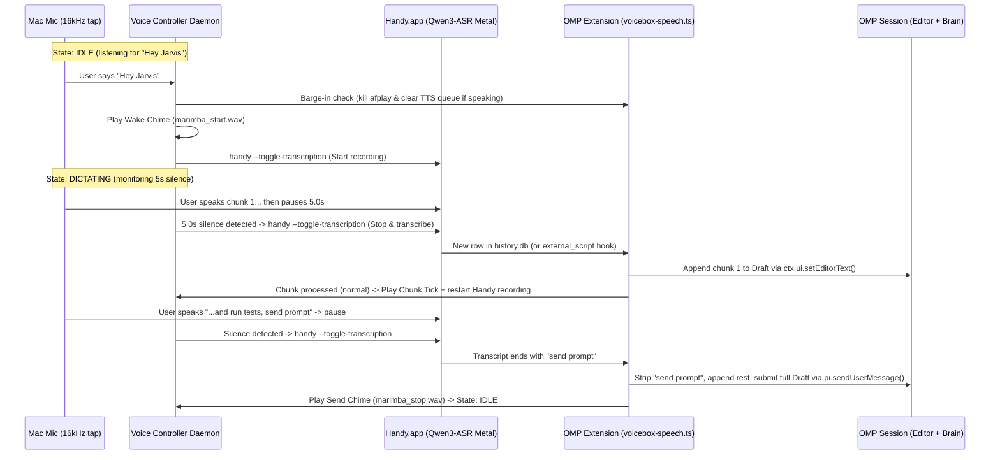

# Spec: Stage 1 OMP Hands-Free Voice Loop (Handy + VoiceBox)

## 1. Overview & Architecture

## 2. Components

### 2.1 OMP Extension (`~/.omp/agent/extensions/voicebox-speech.ts` or `~/.omp/agent/extensions/omp-voice-loop.ts`)
1. **Barge-In Support in `voicebox-speech.ts`**:
   - Track the active `afplay` child process (`activeAfplay: ChildProcess | null`) and a `speechEpoch` counter.
   - Expose a local control endpoint or state file / Unix socket (or HTTP on `127.0.0.1:17494`) with:
     - `POST /barge-in`: increments `speechEpoch`, kills `activeAfplay`, clears `queued` / `spoken`, and returns `{ stopped: true }`.
     - `GET /status`: returns `{ speaking: boolean, dictating: boolean, draftLength: number }`.
     - `POST /transcript`: receives `{ text: string, id?: number }` (or polls `~/Library/Application Support/com.pais.handy/history.db` for new `id > lastSeenId` when OMP voice mode is active).
2. **Draft Accumulation & Command Phrase Parsing**:
   - Normalized phrase check at the end of (or matching the entire) transcript (case-insensitive, ignoring trailing punctuation `.!?,`):
     - **Send Phrase** (`"send prompt"`, `"submit prompt"`, `"press enter"`):
       - Strip the trailing command phrase from `text`.
       - Append any remaining leading text to `ctx.ui.getEditorText()`.
       - Read full `finalDraft = ctx.ui.getEditorText().trim()`.
       - Clear editor via `ctx.ui.setEditorText("")` and call `pi.sendUserMessage(finalDraft)`.
       - Return `{ action: "sent" }` so the Voice Controller plays the Send chime and transitions to `Idle`.
     - **Pause Phrase** (`"pause listening"`, `"stop listening"`):
       - Strip the trailing command phrase, append any remaining leading text to `ctx.ui.getEditorText()` (no Enter).
       - Return `{ action: "paused" }` so the Voice Controller plays the Pause tone and transitions to `Idle`.
     - **Cancel Phrase** (`"cancel that"`, `"discard chunk"`):
       - Do not append the chunk to `ctx.ui.getEditorText()`.
       - Return `{ action: "cancelled" }` so the Voice Controller plays the Cancel tone and transitions to `Idle`.
     - **Normal Chunk**:
       - Append `text` to existing `ctx.ui.getEditorText()` (separated by a space if non-empty) via `ctx.ui.setEditorText(nextDraft)`.
       - Return `{ action: "appended" }` so the Voice Controller plays the Chunk tick and immediately re-toggles Handy (`handy --toggle-transcription`) for the next chunk.
3. **Slash Commands in OMP**:
   - `/voice on` | `/voice off` | `/voice status` | `/voice send` — allows toggling or inspecting the voice controller directly from OMP.

### 2.2 Local Voice Controller (`~/.local/bin/omp-voice-controller`)
1. **Audio & Wake Word**:
   - Lightweight single-process daemon capturing 16 kHz mono PCM from the default macOS mic.
   - In `Idle`, listens for the Wake Word (`"Hey Jarvis"` / `"Jarvis"`) via local keyword spotting (`openwakeword` `hey_jarvis` model or macOS on-device `SFSpeechRecognizer` / `SpeechAnalyzer`).
   - When Wake Word fires:
     - Calls `POST http://127.0.0.1:17494/barge-in` to silence VoiceBox if speaking.
     - Plays Wake chime (`/Applications/Handy.app/Contents/Resources/resources/marimba_start.wav`).
     - Starts Handy recording (`/Applications/Handy.app/Contents/MacOS/handy --toggle-transcription`).
     - Enters `Dictating`.
2. **5-Second Pause Detection in `Dictating`**:
   - Tracks speech onset (VAD / RMS threshold) and silence duration.
   - **Normal Chunk Flush**: Once speech has been detected in the current chunk and **5.0 seconds of continuous silence** elapses, calls `handy --toggle-transcription` to stop and transcribe the chunk.
   - **Fast Command Flush**: Wait for Handy to write the new row to `history.db` (~170 ms), forward it to OMP extension `/transcript`, and act on `{ action }`:
     - If `action === "appended"`: play subtle tick (`/System/Library/Sounds/Tink.aiff`), call `handy --toggle-transcription` to immediately start recording the next chunk, and stay in `Dictating`.
     - If `action === "sent"`: play Send chime (`marimba_stop.wav`) and transition to `Idle`.
     - If `action === "paused"` or `"cancelled"`: play confirmation tone (`/System/Library/Sounds/Pop.aiff` / `Basso.aiff`) and transition to `Idle`.
   - **Idle Timeout in `Dictating`**: If no speech at all occurs for 15 seconds after entering `Dictating` (or after a chunk flush), call `handy --cancel` and return to `Idle` so Handy doesn't stay recording an empty room forever.

### 2.3 Handy Configuration (`~/Library/Application Support/com.pais.handy/settings_store.json`)
- While OMP Voice Controller is active:
  - `mute_while_recording: false` (so Audio Cues and Barge-in aren't muted by Handy).
  - `paste_method: "none"` (or `"external_script"` pointing to the OMP bridge script) so Handy does not double-paste via `Cmd+V` into the terminal while the OMP extension already updates `ctx.ui.setEditorText()`.
  - `model_unload_timeout: "hour1"` so `Qwen3-ASR-1.7B-Q8_0.gguf` stays warm in Metal across thoughts.
